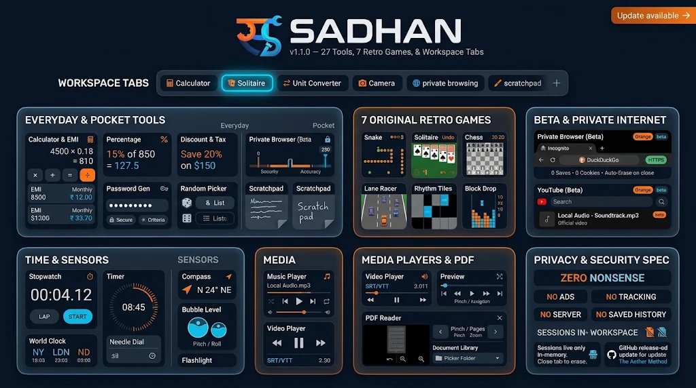

# SADHAN

**An all-in-one daily toolbox for Android.** साधन — *instrument, tool.*

Every small task you reach for a different app to do, in one place — built the way a fine tool is built: nothing there for show, nothing watching you.



*Owner-provided design reference. Actual screens and layouts adapt to your
device; this illustration is not a device screenshot.*

> **v1.1.0:** 27 tools, seven original retro games, session-only workspace tabs,
> and a signed native Android APK distributed on
> [Releases](https://github.com/Unigalactix/SADHAN/releases/latest).
> The build specification and implementation notes live in [SPEC.md](SPEC.md).

**Quality candidate:** v1.2.0-rc.1 adds focused Tools/Media/Games navigation,
confirmed workspace closes, progressive RAM-only libraries, playback and
browser recovery fixes, localized number entry and adaptive game controls.
It is a prerelease; v1.1.0 remains stable. The implementation and honest
device/human acceptance gates are tracked in [QUALITY.md](QUALITY.md).
See the [actual Light/Dark master-screen captures](QUALITY.md#six-master-screen-hand-off),
separate from the concept artwork above.
The candidate's higher versionCode prevents an in-place downgrade to v1.1.0;
returning to that older stable build requires uninstalling and loses Settings.

## Download

1. Download the latest **SADHAN APK** from [Releases](https://github.com/Unigalactix/SADHAN/releases/latest).
2. Open it on your phone. Android asks once to allow installs from your browser or file manager.
3. Open SADHAN and use any tool. No sign-up. Ever.

Needs Android 10 or later. Every release is signed with the same key, so new versions install over old ones — and the app itself tells you when an update is out (see *Updates* below).

**Website:** [unigalactix.github.io/SADHAN](https://unigalactix.github.io/SADHAN/)
— responsive landing page, tool catalog, developer links, and latest-release
download buttons.

## Zero nonsense

- **No ads.** Not one ad SDK.
- **No tracking, no analytics.** No telemetry, no crash-reporting phoning home.
- **No account and no server of ours.** There is nothing to sign up for.
- **No saved history.** Open tool tabs live only in memory. Switch between them
  without losing work; close a tab to erase it. No tabs, queues, game progress,
  notes or browser history are restored after the app process ends. Only
  Settings, including your chosen document-library folder, persist.
- **No paywalls.** Everything is there from the first launch.

## The toolbox

Open up to six tool/game tabs. Music and timers can continue while you use other
tabs in the foreground; hidden cameras, video and games pause. Tablets and
foldables offer a companion-tool pane without putting controls across a
separating hinge. Rotation/resizing keeps the active in-memory session.
Choose **System** (default), **Light**, or **Dark** in Settings. Frosted light and
navy glass surfaces use orange controls, cyan readouts and reduced-motion-aware
transitions.

**Everyday**
- Calculator — full expression evaluator, session-only history
- Tip & Split — bill, tip %, per-person totals
- EMI Calculator — monthly EMI, total interest, total payable
- Age & Dates — exact age, days between dates
- Unit Converter — length, weight, temperature, data, area, speed
- Percentage — percentage of amount, share, and percentage change
- Discount & Tax — discount, savings, tax after discount, final price

**Pocket**
- QR Maker — text to QR, share or save
- QR Scanner — camera decoding, copy or open the result
- Text Tools — word/char counts, case changer, duplicate-line remover
- Scratchpad — a note that erases itself when its tab closes
- Image Compressor — shrink a photo, see before/after sizes
- Random Picker — list options, whole numbers, six-sided dice
- Password Generator — secure on-device randomness, selectable character types

**Time**
- Stopwatch — with laps
- Timer — a needle dial you drag, not a number pad
- World Clock — ten cities, live

**Internet** *(each can be switched off in Settings)*
- Weather — Open-Meteo: no key, no account
- Currency — Frankfurter rates for 15 major currencies
- YouTube — **BETA** *(see below)*
- Private Browser — **BETA**, HTTPS browsing with session-only private tabs

**Sensors**
- Flashlight, Compass, Bubble Level

**Media**
- Music Player — opt-in device library, multi-file queue, previous/next,
  seek, speed, repeat all/one, and shuffle
- Video Player — device library, audio/subtitle track selection, external
  SRT/VTT/SSA/ASS/TTML subtitles, speed, fit/fill/zoom/ratios, volume, subtitle
  size, fullscreen and queues (AndroidX Media3)
- PDF Reader — page navigation, pinch zoom/pan, and a chosen-folder document
  library; other document formats open in an installed viewer

**Games — original, native, offline, no saved scores**
- Snake — swipe/D-pad, adjustable speed
- Solitaire — draw-one Klondike, foundations, tableau moves, undo
- Chess — local two-player, legal moves, castling, en passant, promotion,
  checkmate/stalemate and draw rules; no chess engine or online play
- Pixel Runner — original jump-and-run with platforms, gaps, stars and lives
- Lane Racer — three-lane 2D traffic dodging
- Rhythm Tiles — timed taps with procedural piano tones
- Block Drop — original 10 × 18 falling-block puzzle with rotation, row clears,
  levels and a seven-piece bag

No borrowed game characters, artwork, music, ROMs or branded game assets.

The quality candidate adds an untimed, keyboard-accessible Rhythm Tiles
practice mode and pane-constrained game boards with rules and pinned actions.

**About developer** — Rajesh Kodaganti (Rugved), with links to
[portfolio](https://rajeshkodaganti.com),
[LinkedIn](https://www.linkedin.com/in/rajesh-kodaganti-323118215/) and
[GitHub](https://github.com/Unigalactix). Available from Home and About.

Manual file picking still needs no media-library permission. Optional library
scans use `READ_MEDIA_AUDIO`, `READ_MEDIA_VIDEO` and Android 14+ selected-video
access; Android 10–12 uses `READ_EXTERNAL_STORAGE` (maxSdk 32). These were
owner-approved additions. No unrestricted all-files access is requested.
Documents use Android's folder picker; only the folder choice is saved as a
Setting, not an index or recent-file list.

Music pauses when the app is backgrounded or the phone is locked; video pauses
when its tab is hidden. Closing a player tab releases playback and its queue.
No foreground-service/notification permissions were added without approval.
PDF support is for local, seekable, non-password-protected files. Media3 uses
available device decoders; this is not a full VLC codec/DVD/network-feature clone.

The timer is foreground-only, with an alarm tone and system haptic feedback;
it does not schedule background alarms or notifications. Currency values are
dated reference rates, not live trading quotes. AED uses an explicitly labelled
USD-peg estimate because Frankfurter does not supply an AED rate.

## Beta features

Features tagged **BETA** in the app are experimental and may be unstable — the tag means exactly that, so you always know which parts are still settling.

- **YouTube (Beta)** — paste a link or search, and watch in a clean in-app player using YouTube's official embed. Playback can break when YouTube changes things; that's why it's beta.
- Search results remain on YouTube's official mobile site. Selecting a video
  opens its official privacy-enhanced embed with a visible selection and
  return-to-results control. No search API key, scraping or stream extraction.
- **Private Browser (Beta)** — up to eight private tabs inside its workspace
  tab. SADHAN saves no browser history. Cookies, DOM/form storage, file/content
  access, website camera/mic/location requests and downloads are disabled.
  Web data is cleared when the browser tool tab closes. Incognito is not
  anonymity: sites see your IP and can fingerprint you; Android/WebView can
  retain operational data. This is not a forensic-safe browser. Some sites,
  especially cookie-dependent logins, will not work.

## Updates — the AETHER method

SADHAN checks this repo's Releases when it starts. If a newer version exists, it shows an **Update available** card; one tap downloads the new APK and hands it to Android's installer. No Play Store, no server, no account — GitHub Releases is the whole update system. You can switch update checks off in Settings.

## Privacy

Apart from the features you explicitly use, SADHAN makes only these requests:

| For | Asks | Sends |
|---|---|---|
| Weather | Open-Meteo | The city name you typed |
| Currency rates | Frankfurter | Nothing about you |
| YouTube (Beta) | YouTube's official embed | Whatever YouTube's own player sends |
| Private Browser (Beta) | Sites you open; DuckDuckGo for address-bar searches | The address/search you enter and normal website requests |
| Update check | GitHub's release list for this repo | Nothing: it reads the newest release's number |

Your calculations, notes, photos and QR content are processed on the phone.
City searches go to Open-Meteo; YouTube searches and video links go to YouTube.
Sharing or saving an image happens only when you choose it.

## Building

Native Kotlin + Jetpack Compose, single module. JDK 17, Android SDK 35.

```sh
./gradlew assembleRelease
```

Release signing uses a `keystore.properties` kept **outside** the repo (see SPEC.md); without one the APK builds unsigned. The full specification — screens, updater design, permissions, design language — is in [SPEC.md](SPEC.md).

On Windows, run `.\gradlew.bat assembleRelease`. Create an ignored
`local.properties` with `sdk.dir=<Android SDK path>` first.

Validation:

```sh
./gradlew testDebugUnitTest lintRelease
./gradlew connectedDebugAndroidTest
```

The device tests need a connected Android 10+ device or emulator. Source is
organized into per-tool screens with shared `core`, `data`, `media`, `ui/theme`
and `update` packages; no database or tool persistence is used.

[Android quality CI](.github/workflows/android-quality.yml) builds unsigned
test artifacts and preserves reports and actual emulator master-view captures.
CI artifacts are not permanent signed releases. Release-candidate evidence and
remaining physical-device/human checks are listed in [QUALITY.md](QUALITY.md).

### Reporting problems

Use **About > Report an issue** or the
[GitHub issue form](https://github.com/Unigalactix/SADHAN/issues/new/choose).
No diagnostic or tool contents are attached automatically. Use made-up sample
inputs and remove private URLs, filenames and personal screenshots.

The initial v1.0.0 release was validated with 10 JVM tests, release lint and
eight Android 15/API 35 device tests. The v1.1 checks include 24 JVM rule tests,
13 phone UI scenarios, 12 foldable UI scenarios and a closed/half-open/open
posture-continuity test. They cover workspace tabs, themes, resize continuity,
private browsing, media controls/subtitles, library scanning, and game/utility
rules. The small-pane calculator keeps its display and main action pinned.
Physical sensors, camera optics, and all device-specific codecs still need
on-device evaluation; YouTube remains beta.

See [third-party notices](THIRD_PARTY_NOTICES.md) for libraries and service
attributions.

### Landing page

The static site is in [docs/](docs/), with no framework, build step, external
fonts, analytics, or package dependencies. GitHub Pages publishes from the
`main` branch, `/docs` folder. Its download buttons look up the latest release;
if GitHub's API is unavailable, they still link to the Releases page.

Brand assets use the four owner-supplied variants: light launcher, dark web
icon, monochrome splash mark, and full website wordmark.

## Principles

Small tasks, done properly, with no AI and no agenda. Quality is measured, never claimed. If a tool can't do something, it says so.

## Licence

[MIT](LICENSE). Copyright © 2026 Rajesh Kodaganti.
